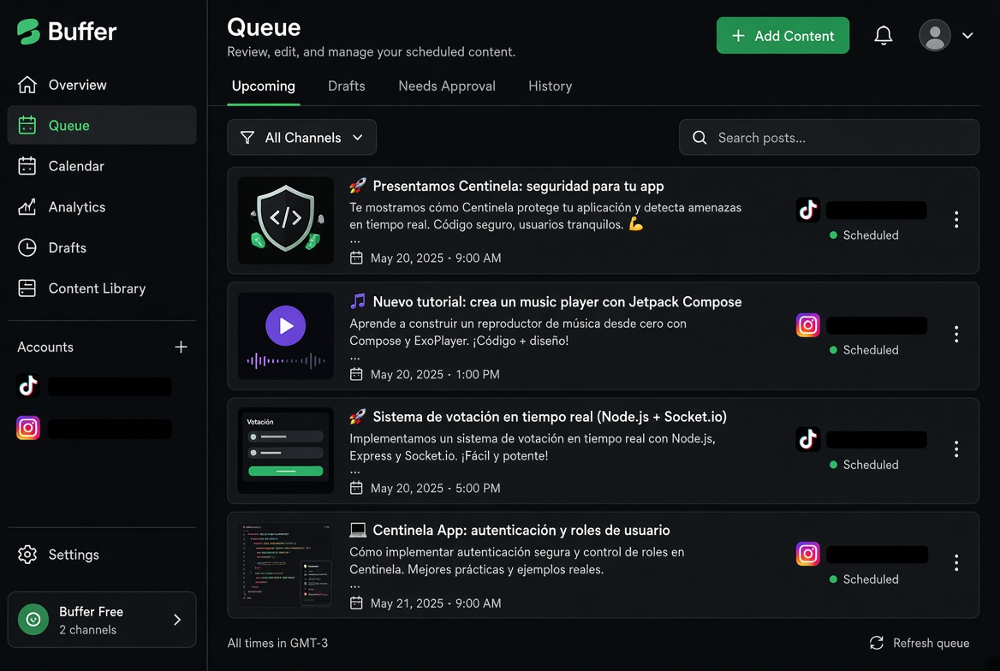
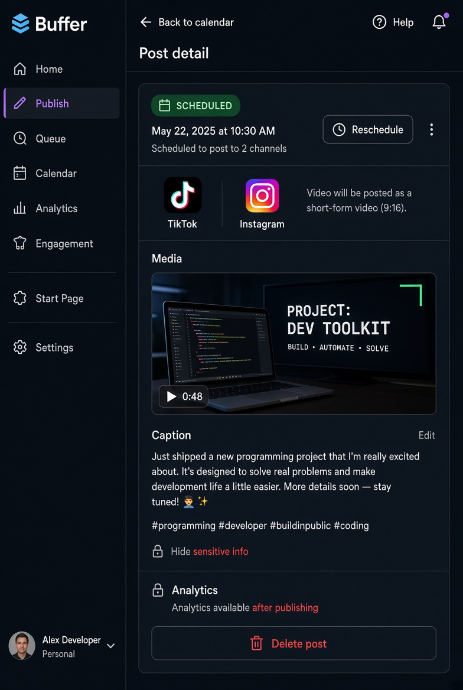

# Content Automation for Trabajos de Programación
### Video generation + scheduled publishing with Buffer MCP

**High-level documentation of the content automation pipeline for the [Trabajos de Programación](https://www.tiktok.com/@trabajosdeprogramacion) / [Instagram](https://www.instagram.com/trabajos.de.programacion/) entrepreneurship.**

> The full prompt flow, video generation process, and detailed orchestration remain private for business and operational reasons. This document covers the architecture, tools used, and real results only.

---

## Overview

An automated pipeline was built that generates programming-related content (short videos + captions) and schedules it on TikTok and Instagram using Buffer’s official MCP Server, controlled from an AI agent.

The goal is to maintain consistent social presence without daily manual work.

---

## Problem

Keeping fresh and frequent content on TikTok and Instagram for a programming services business is time-consuming:

- Generating relevant ideas
- Producing short, quality videos
- Writing captions and hashtags
- Scheduling at optimal times

Doing this manually does not scale.

---

## Solution (high-level architecture)

```
AI Agent
    ↓
Video + caption + hashtag generation
    ↓
Buffer MCP (schedule / queue)
    ↓
TikTok + Instagram (scheduled publishing)
```

### Main tools

| Component      | Technology                  | Role                                      |
|----------------|-----------------------------|-------------------------------------------|
| Orchestration  | AI Agent + MCP              | Flow control and decision making          |
| Publishing     | Buffer MCP Server           | Schedule and manage the queue             |
| Channels       | TikTok + Instagram Business | Final destinations                        |
| Content        | Short videos + captions     | Programming and project posts             |

---

## Real results

A multi-day content calendar was generated and scheduled on both channels. Examples from the current queue:

| Scheduled date     | Platforms    | Main topic                          |
|--------------------|--------------|-------------------------------------|
| Nov 30, 2026       | TikTok + IG  | File hiding / steganography feature |
| Nov 29, 2026       | TikTok + IG  | Task timer feature                  |
| Nov 28, 2026       | TikTok + IG  | Hide text/PDF/audio in image        |
| Nov 27, 2026       | TikTok + IG  | Password vault feature              |
| Nov 26, 2026       | TikTok + IG  | Custom alerts feature               |
| Nov 25, 2026       | TikTok + IG  | Music player controls (JS)          |
| Nov 24, 2026       | TikTok + IG  | Voting system results               |

All posts include video and are published in a coordinated way on both platforms.

---

## Demonstrative screenshots (sensitive data redacted)

> Illustrative captures. Personal information, tokens, and sensitive data have been covered.

### Agent interaction


### Buffer queue



### Scheduled post detail



---

## Benefits

- Multi-day calendar ready in a single session
- Consistent publishing without daily effort
- Full control via Buffer (edit, reschedule, or move to draft before publishing)
- Real-world application to an own entrepreneurship

---

## Links

- TikTok: https://www.tiktok.com/@trabajosdeprogramacion  
- Instagram: https://www.instagram.com/trabajos.de.programacion/  
- Portfolio: https://danielpuentes10.github.io/

---

**Real automation project applied to an entrepreneurship.**  
Documented at architecture and results level for portfolio purposes.
